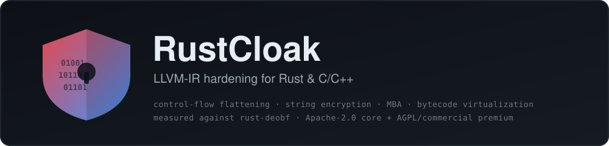
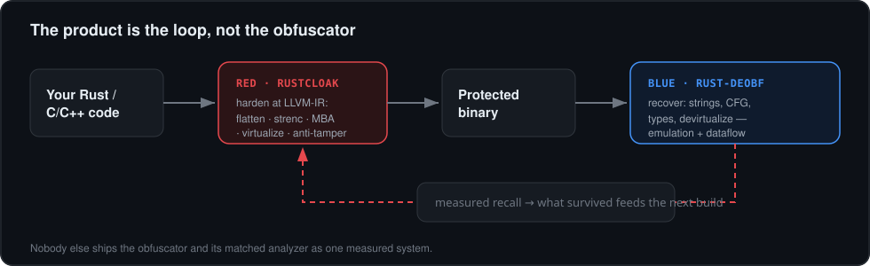

<p align="center">
  
</p>

<p align="center">
  
  
  
  
  
</p>

<p align="center">
  <b>RustCloak hardens Rust (and C/C++) programs against reverse engineering at the LLVM-IR level —
  for protecting intellectual property, and as the <i>red</i> half of a measured red/blue research pair.</b>
</p>

---

## Why this exists

There are already good LLVM obfuscators. What there *isn't* is an obfuscator shipped **together with
its matched analyzer**, so you can measure — not assert — how much protection actually survives.

RustCloak is the **red** side. Its counterpart, [**rust-deobf**](https://github.com/VAHPEM/rust-deobf),
is the **blue** side: a static/dynamic toolkit that recovers strings, control flow, types and
behaviour from compiled binaries. Run them against each other and you get a number, not a marketing
claim.

<p align="center">
  
</p>

This makes RustCloak useful for three honest jobs:

1. **IP protection** — raise the cost of lifting algorithms, keys schedules and license logic out of a
   shipped binary.
2. **Research & teaching** — a reproducible, per-build-randomized corpus for studying what deobfuscation
   can and cannot recover.
3. **Test-case generation** — drive and regression-test rust-deobf (and other analyzers) against known
   ground truth.

> Protection is a cost you impose on an analyst, never an absolute. RustCloak's whole point is to let
> you *measure* that cost with a real tool instead of guessing.

---

## What it does

Everything runs as an LLVM new-pass-manager plugin, on the IR, so it is language- and
architecture-agnostic (same passes harden x86-64, AArch64 and x86; ELF, PE and Mach-O).

| Tier | Pass | What it does |
|------|------|--------------|
| **core** · Apache-2.0 | `flatten` | control-flow flattening (hide block order behind a dispatcher) |
| **core** | `strenc` | string / data-array encryption — no plaintext at rest |
| **core** | `subst` | instruction substitution + iterated mixed boolean-arithmetic (MBA) |
| **core** | `bogus` | bogus control flow + opaque predicates |
| **core** | `constenc` | integer-constant obfuscation |
| **premium** · AGPL/commercial | `virt` | **code virtualization** — functions lowered to per-build-randomized bytecode + interpreter (handles branches, loops, memory, float, direct **and indirect** typed calls) |
| **premium** | `antitamper` | `.text` self-integrity (branch-free; a patched byte silently corrupts) |
| **premium** | `license` | branch-free license-key gate |
| **premium** | `imphide` | import/API hiding via encrypted-name `dlsym` |

Verified behaviour-preserving on **x86-64 (SysV)** and **AArch64 (AAPCS)** by a differential gate
(identical output, baseline vs. obfuscated) plus coverage-guided differential fuzzing — see
[`.github/workflows/ci.yml`](.github/workflows/ci.yml) and `test/`.

---

## Quickstart

```sh
# 1. build the plugin (needs LLVM 18 dev headers)
cmake -S . -B build -G Ninja -DLLVM_DIR="$(llvm-config-18 --cmakedir)"
cmake --build build                      # -> build/libRustCloak.so
#    core-only (Apache-2.0, no premium tier):  cmake ... -DRUSTCLOAK_PREMIUM=OFF

# 2a. C / C++ — load into -O2; it hardens at the end of the pipeline
clang-18 -O2 -fpass-plugin=build/libRustCloak.so input.c -o hardened

# 2b. Rust — one command, works on a stock rustup toolchain
RUSTCLOAK_VM=1 tools/cargo-rustcloak build --release     # see docs/CARGO.md
```

`cargo rustcloak` hardens **only your crate** (dependencies, build scripts and proc-macros pass
through untouched) and lets rustc do the final link, so the output runs normally. See
[`docs/CARGO.md`](docs/CARGO.md) for how it works on rustup (where `-Zllvm-plugins` cannot load the
plugin) and the portable `opt`-on-IR fallback.

---

## Core vs. premium (the two tiers)

| | **Core** (`src/`) | **Premium** (`premium/`) |
|---|---|---|
| License | Apache-2.0 | AGPLv3-or-later **OR** commercial |
| Passes | flatten, strenc, subst/MBA, bogus, constenc | virt (VM), antitamper, license, imphide |
| Build | always | `-DRUSTCLOAK_PREMIUM=ON` (default) |
| For | open use, research, baseline hardening | strong protection + closed-source via a commercial license |

The core never includes or links the premium tier — a `-DRUSTCLOAK_PREMIUM=OFF` build is pure
Apache-2.0. Premium is dual-licensed: use it under the AGPLv3 (copyleft, incl. network use), or buy a
commercial license to use it in a closed-source product. See [`premium/LICENSE.md`](premium/LICENSE.md).

---

## Red/blue — run the real deobfuscator

Rather than proxy metrics (entropy, fold-survival), `test/redblue.sh` runs the actual counterpart,
[rust-deobf](https://github.com/VAHPEM/rust-deobf), against RustCloak's own VM output and reports what
it recovers. On the single-function fixture `test/vm_one.c`:

| blue tool | technique | plain `virt` | `+VM_JMP` | `+INTEGRITY` | `+NEST` |
|-----------|-----------|:---:|:---:|:---:|:---:|
| `detect_vm.py` | static VM detection | not detected | — | — | — |
| `lift_vm.py` | static bytecode lift | not lifted | — | — | — |
| `devirt_emulate.py` | Unicorn emulation | **recovered** | **recovered** | **defeated** | **defeated** |

The honest reading: structural VM hardening already defeats the *static* detector and lifter, but
emulation reconstructs the computation regardless of structure — so plain virtualization falls to an
emulating devirtualizer. What resists it here is **bytecode integrity** (operand keys become a run-time
function of the bytecode hash) and **nested virtualization**. This is the measured state of the art, not
an assertion — and it is exactly why shipping the analyzer alongside the obfuscator matters.

---

## Build-time flags (environment variables — work through clang and rustc alike)

| flag | effect |
|---|---|
| `RUSTCLOAK_HARDEN=1` | one-switch strong preset (VM + integrity + jump-table + two-way bogus + runtime string keys + depth-2 MBA) |
| `RUSTCLOAK_SEED=N` | reproducible build (default: random per build → two builds share no instruction set) |
| `RUSTCLOAK_SUBST_DEPTH=N` | iterate MBA substitution to depth N (1..4) |
| `RUSTCLOAK_VM=1` | virtualize eligible functions (premium) |
| `RUSTCLOAK_VM_SELECTIVE=1` / `_ONLY=a,b` / `_SKIP=a,b` / `_RATIO=P` | scope the VM to sensitive functions |
| `RUSTCLOAK_VM_JMP=1` | encrypted `indirectbr` jump-table dispatch |
| `RUSTCLOAK_VM_INTEGRITY=1` | VM self-hashes its bytecode; tampering corrupts the operand keys |
| `RUSTCLOAK_VM_NEST=1` | re-virtualize the interpreter (VM-in-VM; ~100× slower) |
| `RUSTCLOAK_STRENC_SYSCALLKEY=1` | derive the string key from a runtime syscall (research: resists constructor-replay emulation) |
| `RUSTCLOAK_ANTITAMPER=1` | `.text` self-integrity (needs `tools/antitamper_patch.py` post-link) |
| `RUSTCLOAK_LICENSE=<hex>` / `RUSTCLOAK_HIDE_IMPORTS=a,b` | license gate / import hiding |
| `RUSTCLOAK_OFF=1` | disable all transforms (safety off-switch) |

Full flag reference and the VM ISA: [`docs/VM-ISA.md`](docs/VM-ISA.md), [`docs/CARGO.md`](docs/CARGO.md),
[`docs/VM-ELIGIBILITY-ROADMAP.md`](docs/VM-ELIGIBILITY-ROADMAP.md).

---

## Layout

```
src/        core transforms (Apache-2.0): Flatten, StrEnc, Subst, Bogus, ConstEnc, Plugin, RustCloak.h
premium/    premium tier (AGPL/commercial): Virt (VM), AntiTamper, License, ImportHide + licenses
tools/      cargo-rustcloak wrapper, swap-linker, antitamper patcher
test/       differential correctness gate, arch/format matrix, fuzzers, red/blue harness
docs/       VM ISA, cargo guide, eligibility roadmap, packing design, images
```

## License

Core (`src/`): **Apache-2.0** — see [`LICENSE`](LICENSE).
Premium (`premium/`): **AGPLv3-or-later OR commercial** — see [`premium/LICENSE.md`](premium/LICENSE.md).

RustCloak is for protecting software you own and for authorized security research. You are responsible
for using it lawfully.
